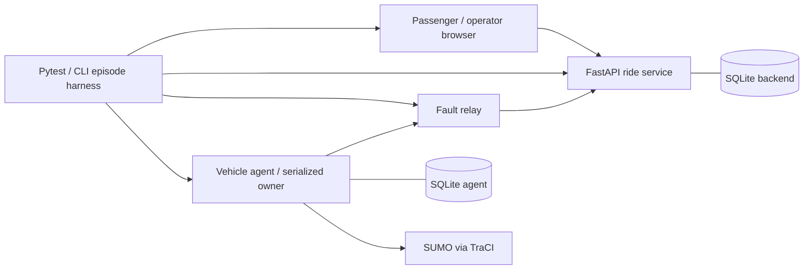

# Local architecture and repository map

The backend owns mission intent; SUMO observations own execution evidence. Only the agent steps SUMO. Fault rules act on application messages; lab controls stay available during a partition. Browser tests use Chromium through Playwright against the real service.

- `services/ride_service/app.py`: validated HTTP contracts, atomic SQLite state/outbox/inbox, revision guards, late event projection, completion receipt, incident/timeline APIs.
- `services/vehicle_agent/main.py`: persistent protocol state, lease fallback, observed dwell gates, fault-channel exchanges, serialized lab controls and checkpoints.
- `services/fault_relay/app.py`: command holds, deterministic release/reordering, duplicates, acknowledgement suppression, partitions, obsolete lease injection and attempted/delivered message evidence.
- `lab/simulator.py`: synthetic network build and verified TraCI motion/stop adapter.
- `lab/harness.py`: isolated ports/directories, bounded startup and stepping, actual process restart, process-group cleanup, artifact capture.
- `validation/scenarios.py`: reusable scenario procedures, separate from the product; `validation/oracles.py`: external trajectory/domain checks.
- `scenarios/catalog.json`: predeclared requirement cells, bounds, seed and artifacts; `scenarios/runs.json`: CLI names.
- `tests/`: SIL procedure wrappers, HTTP boundary validation, independent oracle negative checks, browser workflows.
- `lab/report.py`: outcomes, missing-cell denominator, raw measured timing ranges and scoped readiness.
- `web/index.html`: minimal passenger and operator workflows.

The seed, versions, platform, source digest, base commit, scenario definition and deadlines are captured before each run. Databases are unique per episode. Process restarts retain the episode's databases. A replay is a new episode and never overwrites evidence.

Product APIs: POST /rides, GET /rides/{id}, POST /rides/{id}/cancel, /pickup, /ready; GET /rides/{id}/timeline; GET /vehicles/taxi/commands; POST /vehicle-events; GET /operations/incidents; GET /health and /ready. OpenAPI is available on the backend at /openapi.json and /docs.

Agent lab APIs: POST /lab/step (1–20 steps), /lab/occupancy, /lab/simulator-exit; GET /lab/state. Relay lab APIs: POST /lab/faults; GET /lab/evidence. Backend POST /lab/clock advances observer freshness time. Mutation controls require LAB_MODE=1 and all launchers bind loopback. The command endpoint is exclusively consumed through the relay during normal test stepping.
